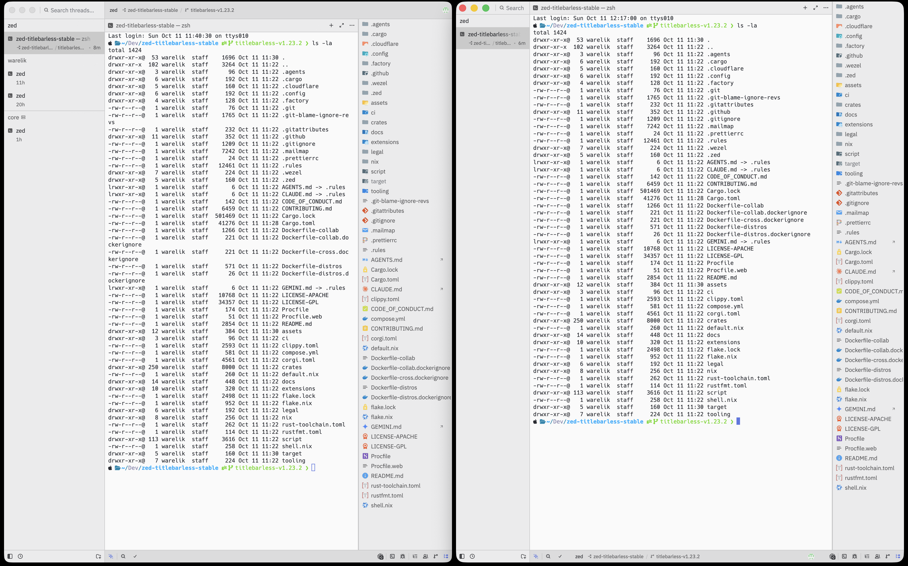
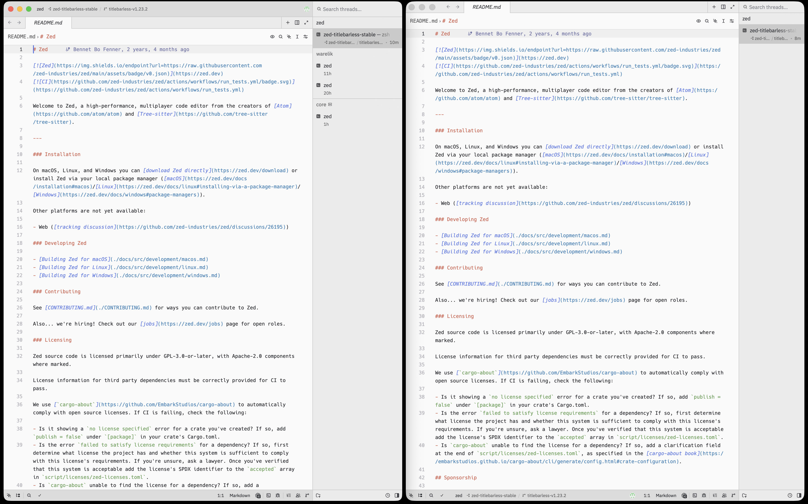
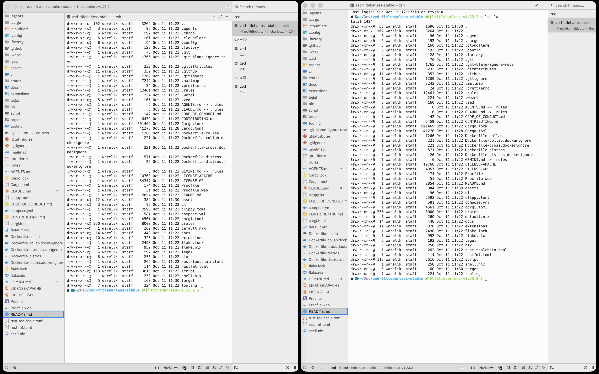
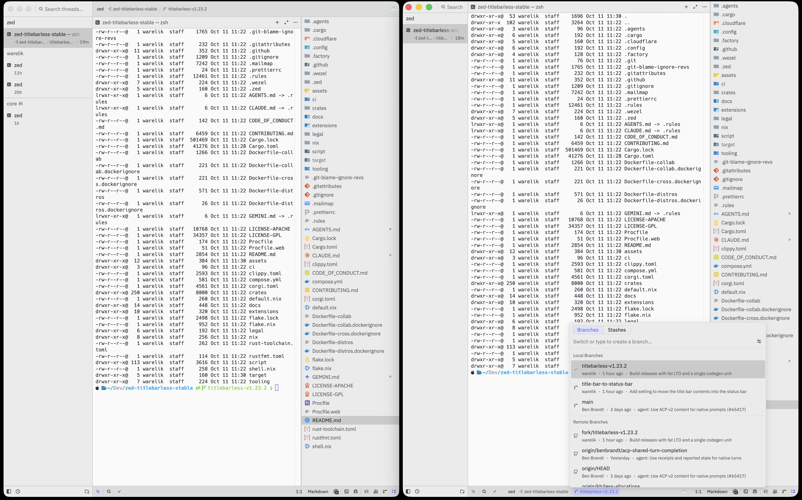

# zed-titlebarless

[Zed](https://github.com/zed-industries/zed) stable for macOS (Apple Silicon) with one goal: every row of the window does useful work.

Zed without the title bar: titlebarless, title-less, no titlebar, hidden or hide title bar, compact title bar — the title bar contents live in the status bar instead.

This fork keeps a small set of requested layout changes and fixes for terminal persistence and remote reconnection. It follows upstream rather than developing a separate editor.

**Download:** [latest release](https://github.com/warelik/zed-titlebarless/releases/latest)

## Title bar → status bar

```json
"title_bar_to_status_bar": true
```

Add it to `settings.json`; there is no Settings UI entry. macOS only: Windows and Linux draw their window controls in the title bar, so they ignore it (this fork releases for macOS only). Nothing is removed — it's re-composed:

- the title bar contents (project and branch pickers, collab, user and app menus) move into the status bar, and their popovers open upward;
- the freed row goes to the editor;
- the traffic lights get their own room in the top-left corner (threads sidebar, left dock or the first tab bar; a top-left pane without a tab bar and zoomed panes and panels get a row of the tab bar height), so nothing overlaps;
- that room and the empty part of tab bars drag the window.

Off by default; off means stock Zed. Upstream PR: [zed-industries/zed#65471](https://github.com/zed-industries/zed/pull/65471).

Left: stock. Right: `title_bar_to_status_bar: true`.

Threads sidebar on the left:


Left dock closed, tabs start after the traffic lights:


Left dock open:


Popovers open upward from the status bar:


## Also in this build

Without any setting:

- The threads sidebar minimum width is halved (200 → 100 px). The clamp also applies to `agent.threads_sidebar.default_width`, so its valid range now starts at 100. This is intentional with `compact` and `in_agent_panel` disabled too; those switches control layout, not this independent width change.
- Single-line editors (such as the threads sidebar search) reserve one em instead of two after the text.
- A flat light theme, Mono Light, is bundled. It only appears in the theme picker (`"theme": "Mono Light"`); the default theme is unchanged.
- Auto-update uses this repository's immutable releases. Same-version fixes use the native GitHub `release.id` without changing Zed's upstream version; SSH remoting still downloads the official remote server. Already-installed clients learn this comparison on a one-time install or their next ordinary higher-upstream-version update.
- Managed terminal threads created or restored in the agent panel keep their shell in a [shpool](https://github.com/shell-pool/shpool) session when `shpool` is on the host's `PATH`, so they survive restarts and dropped SSH connections; closing one with its × button removes its session. Terminal tabs dragged into the agent panel remain non-persistent and follow the terminal’s native close decision. Completed tasks retain their output according to their hide setting; ordinary interactive shells still close on a normal exit. New threads without shpool run a plain shell as before. Each managed session retains its original absolute shpool client and socket in recoverable metadata; changing project roots, PATH or XDG settings cannot retarget its destructive close. Restore and restart reuse that locator through the existing workspace/SSH connection. No terminal environment or credentials are copied into the locator. Legacy records without it require a positive session-UUID match before adoption; an absent or ambiguous session keeps its record instead of starting a duplicate or claiming termination. Probe errors are surfaced instead of silently falling back to a plain shell; probe and close commands that do not complete time out after 17 seconds. A timed-out close keeps its metadata and can be retried.
- Manual and automatic SSH reconnect stop retrying after a password prompt is canceled or unavailable, or after an authentication failure is verified. A retry action remains available with the actual disconnect reason; transient failures continue retrying with backoff.
- On macOS `--user-data-dir` also holds the logs, as documented, so a second instance no longer writes into the default instance's `Zed.log`.

### Optional density settings

Every setting below defaults to stock Zed. None of them has a Settings UI entry: edit `settings.json`. They are part of the patches in [`patches/`](patches).

```json
{
  "title_bar_to_status_bar": true,
  "tabs": { "min_width": 120, "max_width": 200 },
  "tab_bar": { "pinned_tab_chips": true, "unpinned_tab_chips": true },
  "toolbar": { "compact": true },
  "panel_rows_tab_height": true,
  "agent": { "threads_sidebar": { "compact": true, "in_agent_panel": true } },
  "shadows": { "project_panel": false, "minimap": false }
}
```

| Setting | Default | Effect |
| --- | --- | --- |
| `title_bar_to_status_bar` | `false` | See above. macOS only. |
| `tabs.min_width` / `tabs.max_width` | `null` | Clamp tab width in px; `null` keeps tabs as wide as their title. With a maximum, editor and terminal titles are truncated in the middle. |
| `tab_bar.pinned_tab_chips` / `tab_bar.unpinned_tab_chips` | `false` | Render the pinned or unpinned tabs as borderless chips that hug their content, as tall as the toolbar's default buttons. |
| `toolbar.compact` | `false` | The pane toolbar gets the height of the tab bar: no vertical padding, no gap above secondary rows, and search rows, errors, hints and banners are sized to the tab height, so a single-row toolbar equals the tab bar. The search bar above an agent panel terminal is compacted too. |
| `panel_rows_tab_height` | `false` | Every row in the project, git and outline panels takes the tab bar height. |
| `agent.threads_sidebar.compact` | `false` | Each thread is one row at the tab bar height; hovering a thread shows its metadata and actions instead of the title. Project group headers and the "No threads yet" row take the same height. |
| `agent.threads_sidebar.in_agent_panel` | `false` | The threads sidebar is not shown; its contents become two tab rows at the top of the agent panel, in place of the thread title: the window's projects, then the threads and terminals of the active project. The rows use the editor's tabs and tab settings (chips, width bounds, close button). Click activates, double-click renames, middle-click or × archives a thread or closes a terminal, right-click opens the sidebar's menu. Thread history is in the agent panel's ⋯ menu. |
| `shadows.project_panel` | `true` | `false` removes the shadow under the sticky folder rows of the project panel. |
| `shadows.minimap` | `true` | `false` removes the shadow around the minimap. |

See [Known limitations](RELEASE_NOTES.md#known-limitations).

## Install

1. Open `Zed.dmg` and drag Zed to Applications. It replaces the official Zed.app: same bundle id, same settings and data.
2. The build is ad-hoc signed and not notarized, so remove the quarantine flag once:

   ```sh
   xattr -dr com.apple.quarantine /Applications/Zed.app
   ```

## How it's built

- [`patches/`](patches) holds the minimal ordered patch series on one supported upstream snapshot. The workflow selects an exact stable source SHA, applies the patches in filename order, and records the resulting patch-set digest.
- [`.github/workflows/release.yml`](.github/workflows/release.yml) obtains the exact private lifecycle source named by the public lock file; the loader verifies its revision and SHA-256 before import. The source is not copied into this public repository or release artifacts. It coordinates two independent exact-source Codex reviews: every new or modified patch/configuration change since the accepted baseline, and the complete assembled project. The full review uses a review-only commit with the exact application tree and the application commit as its sole parent. Both complete finding lists are collected before one batched repair; earlier findings remain open until an exact owner disposition records concrete code and regression evidence. No tests, compilation or builds run during this preparation.
- After both fresh review scopes and the carried finding batch are ready, the candidate is frozen against its full source identity. One final sequence runs the preserved policy tests, all Rust regressions, then the macOS Apple Silicon build, artifact inspection and checksum/provenance validation for one immutable five-asset release. Native final receipts bind each run attempt, its complete job history, and the exact candidate. If publication fails after the heavy job succeeds, the next run may download that exact run-attempt artifact only after the native ledger and artifact receipt verify it; it does not rerun tests or compilation. A failed or incomplete artifact check blocks publication and automatic expensive retries, preserving diagnostics and the last working release. The `artifact_recovery` dispatch input (`<run_id>/<run_attempt>`) republishes one such retained validated artifact under the currently checked controller only: the original candidate, run, receipt, provenance and native review/ledger identities stay frozen, the assembled product and recipe must be identical, the executing branch and trusted policy pin are rechecked at every publication boundary, and the existing macOS job is skipped without refunding its spent attempt.
- Compiler recipes come from the exact selected upstream SHA. Regression binaries use upstream's default test profile and parent CI Cargo configuration; the application uses its unmodified `script/bundle-mac` and release profile. No downstream LTO, codegen-unit, debug-info or debug-assertion overrides are added. The checked controller compares recipes during Linux preparation; proposed policy ports first pass the sandbox and then their checked controller compares recipes on Linux before activation and macOS. An obsolete controller cannot block its own reviewed replacement. The comparison runs again before compilation. All selected regressions compile in one profile, including selector-dependent UI cases. After compilation, test-binary discovery and selected runtime cases use an isolated process group and the selected upstream ordinary-case timeout (60 seconds); a timed-out group is killed and the remaining cases continue. Their failures are reported together; any missing, ignored or failed required case blocks the bundle and publication.
- Receipts identify the application and reviewed configuration. The native ledger carries failures across changed application SHAs, upstream revisions, patch digests and review PRs, and records jobs separately for every `(run_id, run_attempt)`. A retry needs one owner-authored `fork-final-retry` receipt tied to the exact candidate and latest stopped failed attempt; it must predate both the new reservation and every configured heavy job. Ordinary callbacks cannot create a grant or refund a spent attempt. The ledger is checked before reservation and again before macOS setup.
- Proposed policy runs without credentials before adoption. When the shared private source is mounted, the sandbox suppresses raw candidate test output and reports only public test filenames and suite status. Adoption compares the complete scoped product and regression Git trees and preserves every reviewed mode and blob; temporary repair context cannot enter the adopted configuration. The same final run then tests and builds the application; adopting a repair does not trigger a second test/build cycle. A policy-only change with unchanged published application inputs runs the policy suite and skips the application build.
- Ordinary privileged preparation loads only the controller pinned by `ZED_TRUSTED_POLICY`, using the candidate checkout as data. With no trusted pin, agents use the `policy_bootstrap` dispatch only after the exact policy candidate has a verified private bundle receipt. The `verify-bootstrap-bundle` job checks both public native review contexts and the successful private validation attempt through the hash-checked lifecycle loader; it does not import the candidate release controller before that proof. Preparation rechecks the pair, then activation advances the pin after the candidate is ready. Existing pins remain the routine path; the verified bootstrap only reuses policy validation for an exact policy-only candidate and does not start an application build.
- Keep two permanent branches: `main` is an unmodified upstream mirror; `downstream` is the default branch holding patches, workflow and documentation. Native Codex repair PRs use temporary branches and are reviewed and selectively adopted by the workflow.
- Keep one active candidate, its two review PRs and at most one coding task. Superseded review PRs are closed and temporary refs are removed only when the shared native cleanup plan proves their exact pull-ref archive, current branch object and independent survival of any review base. Release identity includes the version, upstream, patch-set digest and exact application commit.
- The preserved real-shpool regression uses the pinned official Apple Silicon shpool fixture in an isolated daemon, home and runtime directory. CI enables that case explicitly and fails if its fixture or activation is missing; it cannot count an early return as verified daemon behavior.
- The five release assets are `Zed.dmg`, `latest.json`, `provenance.json`, `SHA256SUMS`, and the versioned debug-symbol archive. Same-version fixes advance the native GitHub release ID while preserving the official Zed version and SSH remote-server compatibility.
- The release boundary rechecks both reviews, branch identity and verified artifacts immediately before and after publication. Accepted-baseline advancement belongs to the same compensated boundary. If its write commits before a later failure, confirmed withdrawal is followed by restoration of only that publication's checkpoint; a concurrent unrelated checkpoint is refused. An uncertain restoring PATCH is read back before at most three guarded attempts. A failed post-publication check returns the candidate to draft through at most three PATCH/read-back attempts (each API call is bounded to 60 seconds), preserving its diagnostics and the previous working release. GitHub does not offer a transaction covering release, branch and review state; a concurrent invalidation can therefore cause brief visibility before withdrawal. This limitation is not an atomic-publication guarantee.
- Publication is not live installation. This workflow does not restart an editor or remote session; installation and validation of a running version are separate steps.
- [AGENTS.md](AGENTS.md) defines the maintenance, verification, recovery, and cleanup contract. The presence of a workflow does not by itself prove that the entire cycle is automated.

### Debug symbols

Each release attaches `zed-<version>-titlebarless-debug-symbols-macos-aarch64.tar.gz` containing flat DWARF symbols (`zed.dwarf`, `remote_server.dwarf`) and `UUIDS.txt`. Builds inherit the selected upstream release debug-information settings without a downstream override. The final artifact inspection requires compilation-unit debug information and matches each symbol UUID to its binary.

Only `zed.dwarf` corresponds to the shipped `Zed.app` binary. `remote_server.dwarf` is produced during packaging for the macOS remote server, but `remote_server` is not distributed in the DMG (and SSH remoting downloads upstream's official remote server), so it does not match deployed remote binaries.

To symbolicate addresses from a crash report:

```sh
# Match binary UUID from crash report against UUIDS.txt:
# (.ips reports use lowercase UUIDs with dashes; minidump IDs drop dashes.
# UUIDS.txt uses uppercase with dashes, so match case-insensitively.)
grep -i <uuid-from-crash> UUIDS.txt

# Symbolicate address using atos:
# <load-address> is the hex base address of the zed image from the crash report.
# In macOS .ips reports, "base" is decimal; convert to hex with printf '0x%x\n' <base>.
# <crash-address> is the hex instruction pointer address (base + imageOffset).
# atos outputs v0-mangled Rust names; pipe through rustfilt to demangle:
atos -o zed.dwarf -l <load-address> <crash-address> | rustfilt
```

Symbols can also be loaded into LLDB, which demangles names automatically:
```sh
lldb -o "add-dsym zed.dwarf" /Applications/Zed.app
```

### Native mirror authorization

The `main` mirror advances only by the existing exact upstream fast-forward
check. Its ref write uses the already provisioned `CODEX_REQUEST_TOKEN`: the
Actions installation token can reject upstream commits containing workflows
with `Resource not accessible by integration`. Read operations retain their
existing credentials. The mirror contract regression verifies the write token
and preserves the refusal of divergent history; application inputs are unchanged.

Source preparation fetches the selected upstream directly and does not update
the optional `main` mirror. A denied mirror write therefore cannot stop a
reviewed release, and preparing a release does not trigger upstream workflows
on `main`. Mirror housekeeping is separate from the one final release sequence.

Native review inventories are read through the final bounded page and compared in PR-number order. API ordering changes do not invalidate unchanged sources; duplicate numbers and actual source/state changes remain errors.

Maintenance reads current exact review scopes and open carried work. Closed archived discussions are excluded. Before retiring a superseded pair, preserve its unresolved findings through the existing review-history snapshot; resolved findings are not reopened. Closed exact receipt pairs remain verifiable by their explicit PR numbers.

Final reservation readback compares immutable protocol identity and retries only the GET visibility check three times. View-specific API fields do not invalidate a saved reservation, and the POST is never repeated by that check.
